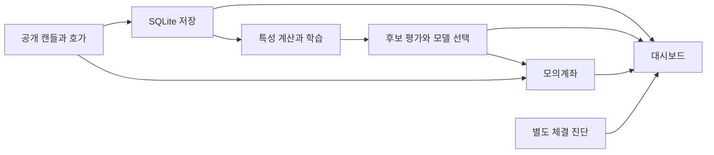

<div align="center">

# 🪙 Upbit Paper Trading Project

## 최신 변경

### 3차 외부50GB 초기학습

[3차 실행 설명](3차/README.md) · [파일별 변경과 전체 비교](3차/변경기록.md) · [저장·준비 계약](3차/docs/요구사항_및_데이터계약.md)

외부 고유아카이브50GB의 다운로드·SHA256검증·스트리밍집계를 마친 뒤GPU학습을 시작하고, 이후업비트에서 요청당200개씩완성봉을누적하며재학습합니다. 기존검증모델의현물모의매매는계속유지합니다. 초기50GB준비중이며확보완료·새모델성적·정확도100%·수익달성을주장하지않습니다.

| 확인된 차수 | 보존과 공개 범위 | 안내 |
|---|---|---|
| 1차·2차 | 로컬보존대응표에서존재확인. 개인운영자료포함압축원본은공개제외, 세부차이비교미확인 | [확인범위와한계](3차/변경기록.md) |
| 기존 공개 기본·GPU개선 | 기존공개Git이력에보존 | [GPU개선설명](docs/versions/gpu-throughput-20261030.md) |
| 3차 | 외부수집·특징·초기학습gate·설정·검사·운영설명 | [3차폴더](3차/) · [변경기록](3차/변경기록.md) |

| 확인된 차수·위치 | 내용 | 설명·비교 |
|---|---|---|
| 기존 공개 기본 | 시세 수집·GPU 연구·현물 모의체결 | [기존 기록](docs/versions/stage-1.md) · [보존 기준](https://github.com/PUVKID/Upbit-Paper-Trading-Project/tree/5d365eeff59b0d6d81607b336f14d238303c57a0) |
| 2026-10-30 GPU 처리량 개선 | 인덱스 정렬·행렬 재사용·1시장 선행 준비·단계 시간 | [설명](docs/versions/gpu-throughput-20261030.md) · [전체 코드 비교](docs/versions/gpu-throughput-20261030-engine-diff.md) · [회귀 검사](tests/test_gpu_throughput.py) |

기존 차수 번호가 확인되지 않아 임의 번호를 붙이지 않았습니다. 이번 변경은 학습 처리량 개선이며 GPU100%상시 사용·정확도95%·수익 향상을 달성했다는 뜻이 아닙니다. [실측과 제약](docs/2026-10-30_GPU처리량_개선.md)을 함께 확인하십시오.

XGBoost 예측과 모의체결·대시보드를 연결한 가상자산 모의투자 도구입니다.

**기술 분류:** 시계열 머신러닝 › 트리 앙상블 › XGBoost·확률 보정·모의체결

`Python`
`XGBoost`
`SQLite`
`모의투자`

[빠른 시작](#quick-start) · [저장소 구성](#repository-structure) · [실험 설정](#data-settings)

[핵심 구성](#input-processing-output)

</div>

<a name="overview"></a>

## ✨ 주요 개발 내용

시세 수집·연구 결과와 호가 기반 모의체결을 연결하는 코드 묶음입니다.

공개 코드의 모의계좌와 실제 주문은 구분합니다.

- PAPER_ONLY 설정으로 모의계좌의 체결과 손익을 기록합니다.
- 엔진의 함수 단위로 시세 처리와 모의 거래 상태 갱신을 추적할 수 있습니다. 연구 모델과 화면은 별도 구성요소입니다.

**자료별 안내:** [기본](docs/versions/stage-1.md) · [전체 기록](docs/VERSIONS.md)

<a name="preview"></a>

<a name="input-processing-output"></a>

## 🔄 입력·처리·출력

| 단계 | 이 프로젝트에서 다루는 내용 |
| :--- | :--- |
| 📥 입력 | 공개 캔들·호가 |
| ⚙️ 처리 | 시계열 특성·구간 분리, XGBoost·보정·모델 선택 |
| 📤 출력 | 모의계좌·평가·대시보드 |


---

<a name="introduction"></a>

## ✨ 프로젝트 소개

공개 시세로 전략을 살펴보고 모의계좌에서 체결 과정을 확인하는 연구 프로젝트입니다.

BTC·SOL·ETH·XRP·DOGE의 공개 시세를 사용해 데이터 수집, GPU 학습, 시점별 평가와 모의체결을 수행하는 연구 코드입니다. `engine.py`는 `PAPER_ONLY = True`로 구성되며 실계좌 주문과 연구 결과를 구분합니다.

| 기능 | 구현 내용 |
| :--- | :--- |
| 시세 수집 | 완료봉만 저장하고 기존 봉을 덮어쓰지 않는 SQLite 수집, 요청 간격 공유 |
| 모델 연구 | 시간순 분할·CUDA XGBoost·앙상블 가중치·확률 보정·후보 승격 |
| 모의체결 | 호가 단계별 부분체결·미체결금액·수수료·슬리피지와 보유 한도 |
| 상태 화면 | 수집·모델·계좌·진단 결과 표시 |
| 운영 감독 | 프로젝트 프로세스와 작업 상태 관리 |
| 진단 | 데이터 무결성, 계좌 조건, 별도 체결 경로 확인 |



<a name="repository-structure"></a>

## 📁 저장소 구성

```text
.
├── engine.py
├── dashboard.py
├── supervisor.py
├── execution_probe.py
├── healthcheck.py
├── 운영.ps1
├── requirements.txt
├── tools/
├── tests/
├── web/
├── upbit_auto_trader_v5.ipynb
└── docs/VERSIONS.md
```

- [연구·모의투자 엔진](engine.py), [대시보드](dashboard.py), [감독 프로세스](supervisor.py).
- [체결 진단](execution_probe.py)과 [운영 상태 검사](healthcheck.py).
- [검사 코드](tests/)와 [버전 기록](docs/VERSIONS.md).

<a name="implementation"></a>

## 🧩 주요 기술과 실행 경계

분석에 쓸 데이터는 NumPy·pandas로 구성하고 XGBoost를 학습합니다. 운영 데이터는 SQLite와 JSON으로 기록합니다. `collector`, `trainer`, `paper`, `experiment`, `check-gpu`가 엔진의 명령 진입점입니다.

`execution_probe.py`는 별도의 2,500만 원 진단 계좌에서 BTC 매수·매도 경로를 검사합니다. 전략 계좌의 기본 1,000만 원과 구분하며, 진단의 최대 배정 비율은 0.1%입니다. 이 결과를 전략 계좌의 거래나 수익과 합치지 않습니다. `healthcheck.py`는 계좌·데이터·장치 근거의 조건을 확인하며, 그 통과가 투자 성능을 의미하지 않습니다.

### 📈 완료봉에서 매매 신호까지

수집기는 공개 캔들과 호가의 GET 요청만 허용합니다. 완료되지 않은 봉은 저장하지 않고, 같은 종목·시간봉·시각의 기존 봉은 `INSERT OR IGNORE`로 보존합니다. 누락된 시각에 가짜 봉을 채우지 않습니다.

특성은 수익률, 변동성, 이동평균, 거래량, 봉의 몸통과 범위 등으로 구성합니다. 여러 시간봉은 과거 방향의 `merge_asof`로 결합합니다. 라벨은 다음 봉 시가에서 진입해 지정한 미래 시각의 종가로 계산하며, 결측봉이 있어도 단순 행 이동으로 다른 시각을 대신하지 않습니다.

### ⏱️ 시간 구간과 모델 승격

학습 → 가중치 조정 → 확률 보정 → 거래규칙 선택 → 후보 검증 → 최종 시험을 구분합니다. 학습과 평가 경계에는 예측 기간을 고려한 간격을 두며, 최종 시험 구간은 노출 예약을 먼저 기록해 같은 구간의 반복 사용을 막습니다. 예약 후 실패한 시도도 사용 이력에서 지우지 않습니다.

앙상블 가중치는 조정 구간에서, 온도 보정은 별도 보정 구간에서 정합니다. 거래규칙에는 거래하지 않는 후보도 있습니다. 후보 승격은 같은 검증 구간에서 로그 손실과 `순수익 - 0.5 × 최대 낙폭`을 비교하며, 라벨 구성이 다른 경우에는 거래 지표 비교로 구분합니다. 단순히 새 학습이 끝났다는 이유로 운영 모델을 교체하지 않습니다.

### 💼 모의계좌의 주문 조건

모의체결은 호가의 가격과 잔량을 순서대로 소비합니다. 잔량이 부족하면 부분체결과 미체결금액을 남기며, 수수료·슬리피지를 반영합니다. 과거 평가에서는 다음 봉 시가를 사용하고, 현재 모의계좌에서는 추론 후 새로 가져온 호가를 사용합니다.

오래된 특징, 미래 시각, 중복 처리 봉은 신규 매수를 막습니다. 일일 손실 한도에 도달해도 기존 포지션 청산 경로는 유지하며, 현금·종목별·전체 배정 한도를 함께 적용합니다. 거래 이력과 계좌 상태는 SQLite 거래 단위로 기록합니다.

### 🧪 보존한 v4 실험과 현재 엔진

[이전 v4 노트북](보존자료/원본/upbit_auto_trader_v4.ipynb)은 4코인·초기 100만 원·5분봉에 15분/1시간 피처를 결합하고, LightGBM·XGBoost·GRU·LSTM·Transformer를 비교하던 별도 실험입니다. 첫 Markdown의 1시간봉·1.5% 설명과 실제 설정인 5분봉·0.6%가 다릅니다. 현재 5코인 엔진에서는 구간 분리·승격·모의체결 조건을 별도로 구성했습니다.

v4에는 `signal_confidence(self, prob)` 정의와 두 호출부의 `(prob, ticker)` 인자가 맞지 않는 부분이 남아 있습니다. 상위 시간봉 피처의 단순 전방 채움, 예측 기간을 비워 두지 않은 분할 경계, Walk-Forward 평가 구간을 LightGBM 조기 종료에 사용한 점도 평가 해석의 제약입니다. 해당 보존 노트북의 전체 실행 성공이나 완전히 독립적인 시험 성능을 보증하지 않습니다.

### 📊 대시보드의 표시 범위

대시보드는 저장된 계좌·학습·진단 자료를 GET 요청으로 읽습니다. 3D 막대는 과거 평가의 예측 표본 개수이며 현재 매매 확률이나 실시간 주문 신호가 아닙니다. WebGL을 사용할 수 없으면 2D 표시로 전환하고, 자료가 없으면 대기 상태를 표시합니다. 화면 모션 정지는 수집·학습·모의체결 프로세스를 중단하지 않습니다.

저장된 기록과 코드의 기본값을 바탕으로 모의거래 흐름을 설명합니다.

<a name="quick-start"></a>

## 🚀 빠른 시작

소스 확인용 Python 환경을 준비하고 명령 구성을 확인합니다.

```powershell
python -m venv .venv
.\.venv\Scripts\python -m pip install -r requirements.txt
.\.venv\Scripts\python engine.py --help
```

실제 운영에는 자신에게 맞는 `engine-config.json`, `service.json`, 실행 경로와 데이터 저장 환경이 필요합니다. 두 설정 파일과 운영 DB·모델·계좌 장부는 이 공개 사본에 포함되어 있지 않습니다.

기존 `운영.ps1`과 Docker 제어 도구는 원래 프로젝트 경로·컨테이너·마운트를 검사합니다. 다른 컴퓨터에서 그대로 실행 가능한 설치 프로그램으로 취급하지 말고 설정과 경로 계약을 먼저 읽으세요. 활성 SQLite를 Windows와 Linux에서 동시에 열지 않도록 실행 환경을 일관되게 유지해야 합니다.

<a name="data-settings"></a>

## 📊 데이터 구성과 실험 설정

| 항목 | 코드의 구성 |
| :--- | :--- |
| 종목 | KRW-BTC, KRW-SOL, KRW-ETH, KRW-XRP, KRW-DOGE |
| 시간봉 | 1·3·5·10·15·30·60·240분과 일봉 |
| 기본봉 | 5분 |
| 기본 의존성 | NumPy, pandas, XGBoost 3.0.5 |
| 수집 자료 | 공개 캔들·호가 |
| 저장 자료 | 캔들 DB, 모델 명세, 실험 결과, 모의계좌 기록 |

아래 값은 `engine.py`의 기본값과 후보 탐색 구성입니다.

| 항목 | 기본값·후보 |
| :--- | :--- |
| 구간 길이 | 학습 180일, 조정 30일, 보정 30일, 규칙 2일, 검증 2일, 최종 시험 30일 |
| 예측 기간 | 기본봉 12개 또는 24개 뒤 |
| 라벨 임계 후보 | 0.6% 또는 0.3%, 체결 비용 반영 |
| XGBoost 깊이 | 3 또는 5 |
| 학습 | 최대 200라운드, 학습률 0.05, 조기 종료 |
| 기본 모의자산 | 10,000,000원 |
| 최대 배정 | 종목별 12.5%, 전체 50% |
| 신규 매수 중단 | UTC 일 기준 손실 1.5% |
| 포지션 조건 | 손절 2%, 익절 4%, 보유기간 종료 |
| 거래 비용 | 수수료 0.05% + 슬리피지 0.05% |
| 최소 금액·호가 나이 | 5,000원, 10초 |

`check-gpu`는 무작위 자료의 짧은 학습으로 CUDA 경로를 검사합니다. 실제 연구 학습도 booster의 장치 설정을 확인하며, CUDA가 준비되지 않았을 때 CPU로 조용히 대체하지 않습니다. `healthcheck.py`의 준비중 상태는 학습 완료나 성능 통과와 다릅니다.

시간순 학습·평가 구간과 잠금 시험 구간을 나누고, 클래스 분포·다수 클래스 기준·Macro F1·Balanced accuracy·비용 반영 모의손익을 함께 검토합니다. 정확도 95%를 목표로 설정했으며, 실제 성능과 모의손익은 실행 결과 파일에 기록합니다.

<a name="troubleshooting"></a>

## 🛠️ 문제 해결

| 증상 | 확인할 내용 |
| :--- | :--- |
| 설정 파일 오류 | 공개 사본에 없는 실행 설정을 준비했는지 확인 |
| Docker 경로 검사가 실패함 | 기존 컨테이너 이름·마운트·프로젝트 경로 계약 |
| SQLite 오류 | 동일 환경의 단일 소유 원칙과 DB/WAL 일관성 |
| GPU 학습을 시작하지 못함 | XGBoost·GPU 드라이버와 장치 확인 결과 |
| 거래가 발생하지 않음 | 거래하지 않기 후보, 신호 확률, 배정 한도, 오래된 특징·호가, 일일 손실 제한 확인 |
| 시험 구간 사용이 거부됨 | 최종 평가 예약·노출 기록과 보호 구간 확인; 기존 이력을 삭제해 재사용하지 않음 |
| 체결 진단 수익이 다름 | 별도 진단 계좌와 전략 계좌의 결과를 구분 |

---

<div align="center">

**데이터와 모델, 모의체결의 근거를 따로 기록합니다.**

</div>

## 🗂️ 현행과 초기 시점 보존

현행 루트와 `3차/`의 원격 7개 파일은 2026-10-30 14:10:39 공개 커밋의 외부 50GB 자료 준비·특징 연결을 반영합니다. `3차/`는 공통 루트 엔진·설정·검사를 참조하는 모듈 보관 단위입니다. 초기 13:38 부분본은 [후속보존/2026-10-30_133824_3차초기부분](후속보존/2026-10-30_133824_3차초기부분/)에 원문 그대로 보존했습니다. 기존 `3차/연결부`와 `3차/검사`는 초기 수집본의 경로도 유지한 사본이며, 현행 엔진과 검사는 루트의 파일을 참조합니다.

<!-- apps-revision-audit -->

## 🧭 모든 차수·보관본과 전체 차이

숫자·버전은 확인된 보관 자료명을 유지합니다. 비교 대상이 없거나 부분 소스인 경우 해당 설명에 표시했습니다.

| 차수·보관본 | 파일·폴더 | 설명 | 공개 파일 전체 비교 |
|---|---|---|---|
| 고유 작업 코드·문서 | [📁 작업소스](보존자료/작업소스/) | [원본 제품자료 목록](docs/SOURCE_MATERIALS.md) | 원래 경로·해시 유지 |
| 2차 · 학습 조건 문서 | [📄 원본 문서](docs/2차_중립원인_연속학습.md) | 연속 학습·중립 원인·과거 계좌 조건 | [제품자료 목록](docs/SOURCE_MATERIALS.md) |
| 3차 · 현행 외부자료 연결 | [📁 원격 7개 파일·공통 루트 참조](3차/) | [구성·실제 비교](docs/versions/3차.md) | [🔍 초기 부분본 → 현행](docs/revision-audit/3차.md) |
| 3차 · 13:38 초기 부분 보존 | [📁 6개 원본·안내](후속보존/2026-10-30_133824_3차초기부분/) | [시점·파일 해시](docs/versions/3차-초기부분.md) | [현행과 전체 차이](docs/revision-audit/3차.md) |
| 현행 공통 엔진·3차 연결 | [📁 루트 실행 입력](.) | [3차 변경 기록](3차/변경기록.md) | [원격 GPU 기준 → 3차 전체 차이](docs/revision-audit/3차-원격변경.md) |
| GPU처리량 | [📁 44개](%ED%9B%84%EC%86%8D%EB%B3%B4%EC%A1%B4/2026-10-30_GPU%EC%B2%98%EB%A6%AC%EB%9F%89) | [자료 범위](docs/revision-audit/GPU%EC%B2%98%EB%A6%AC%EB%9F%89.md) | [🔍 파일·주석·공백·해시](docs/revision-audit/GPU%EC%B2%98%EB%A6%AC%EB%9F%89.md) |

2차 문서는 학습 조건을 기록하고, GPU 개선은 날짜별 코드 스냅샷으로 보관합니다. 루트 실행본과 각 스냅샷을 비교합니다.


### 🖼️ 차수별 화면과 검증 이미지

[원문 이미지·차수별 출처·파일 해시](docs/IMAGE_MATERIALS.md)에서 화면과 합성 테스트 입력을 확인할 수 있습니다.

<!-- privacy-public-copy-20261030 -->

[🔒 공개 사본의 개인 표시·경로 정리와 보존 범위](docs/PRIVACY_PUBLIC_COPY.md) · [변경 기록](docs/changes/2026-10-30-%EA%B0%9C%EC%9D%B8%ED%91%9C%EC%8B%9C%EC%99%80%EA%B2%BD%EB%A1%9C%EC%A0%95%EB%A6%AC.md)


<details>
<summary>🧹 공개 자료 정리 기록</summary>

| 검수 대상 | 연결 자료 | 상세·이번 비교 |
| :--- | :--- | :--- |
| **3차** | [📁 검수 자료](3%EC%B0%A8) | [📖 정리 내용](docs/publication-review/item-1.md) · [🔎 파일 비교](docs/publication-review/공개파일변경.json) |

[🗂️ 전체 차수와 자료](docs/REVISION_INDEX.md)

</details>
